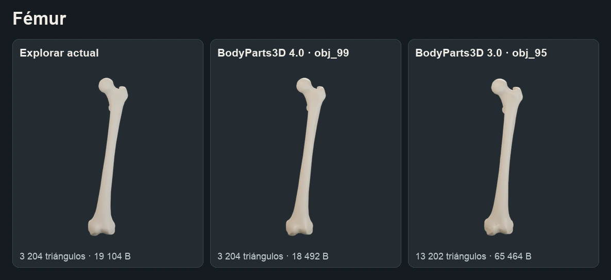
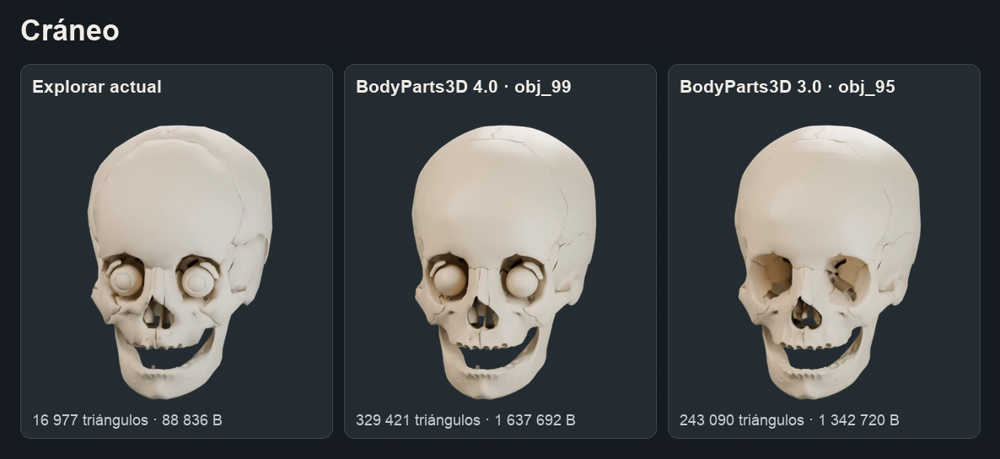
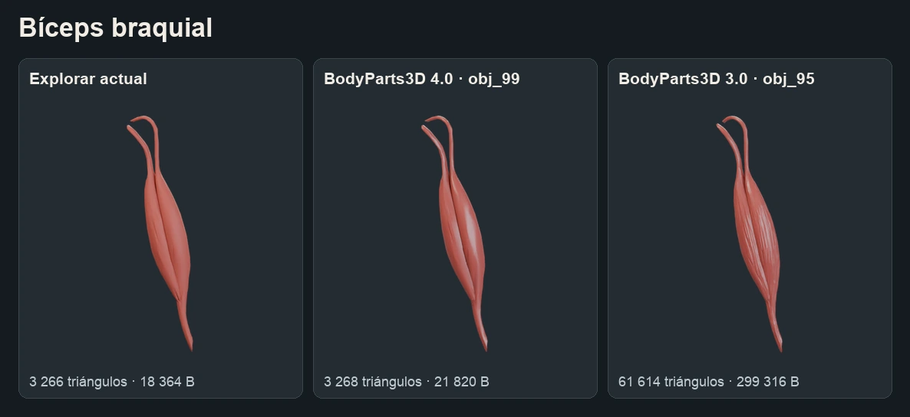
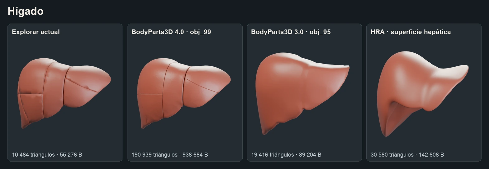
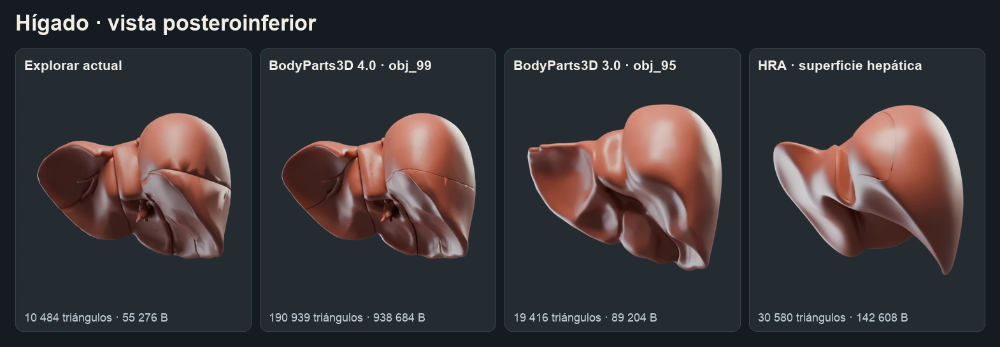

# Explorar 3D · Comparación de modelos

[Inventario de las 24 fichas](inventario.md) · [Ensayo del visor a 375 px y FPS](visor.md) · [30 fichas candidatas](ampliacion.md) · [Propuesta de implementación](../../../PLAN_RENOVACION.md#explorar-3d--renovación-de-modelos)

Los cuatro GLB de regiones de Explorar se generaron a partir de los atlas de Cuerpo y de la geometría suplementaria de atlas y axis. El generador conservó los triángulos y los repartió en nodos para seleccionar las partes. La fuente predominante es BodyParts3D 4.0 `obj_99` y la preparación de Cuerpo aplicó presupuestos por pieza donde hacía falta. Los pulmones incluyen mallas de la edición 3.0. El corazón en corte tiene su propio GLB esquemático. [Fuentes de Cuerpo](../../../../assets/anatomy/FUENTES.md) · [Generación de regiones](../../../../src/content/anatomy/modelos/README.md)

DBCLS publica sus dos paquetes 4.0, IS-A y PART-OF, al 99 % de reducción. El archivo 3.0 incluye paquetes al 95 % y al 99 %. El factor de cinco compara porcentajes de reducción sobre una misma malla original. Las ediciones difieren en su composición y su resolución, como muestra el cráneo. [Descargas de 4.0](https://dbarchive.biosciencedbc.jp/en/bodyparts3d/download.html) · [Archivo 3.0](https://dbarchive.biosciencedbc.jp/data/bodyparts3d/20110915/) · [Descripción de las reducciones en 3.0](https://dbarchive.biosciencedbc.jp/data/bodyparts3d/20110915/README_e.html)

## Renders de Blender

El fémur 4.0 conserva la misma densidad y casi la misma silueta de la ficha actual. El 3.0 mejora el contorno de cabeza, cuello y cóndilos. Su GLB individual de 65 kB permite conservar el detalle.

El conjunto 4.0 elegido reproduce los elementos de la ficha actual, incluidas superficies oculares. El cráneo 3.0 está ensamblado a partir de huesos separados. Se distinguen mejor las órbitas y las suturas. Conviene reducir por hueso y preservar las fronteras al exportar.

El 3.0 aporta detalle de superficie a las dos cabezas y sus tendones. La geometría 4.0 se acerca a la densidad de la ficha actual. Las dos cabezas 3.0 proceden de OBJ identificables, lo que facilita asignar cada región.

HRA presenta una superficie continua con impresiones viscerales. La prueba incorpora la cápsula y el área desnuda, que son dos superficies del mismo GLB. El 3.0 también mejora la continuidad con un solo OBJ. El 4.0 aporta geometría segmentaria y muestra juntas entre superficies. Para conservar los lóbulos seleccionables en HRA habrá que usar sus referencias como guía y separar la superficie visible en regiones revisadas.

## Triángulos y tamaño comprimido

Cada fila mide un **GLB aislado** de la estructura, incluido el control «actual» reexportado y comprimido bajo las mismas condiciones. Los tamaños de descarga de los paquetes compartidos de producción están en el [inventario](inventario.md). Los conteos corresponden al GLB después de limpiar la geometría y comprimirla.

| Pieza | Versión | Triángulos | Bytes GLB |
| --- | --- | ---: | ---: |
| Fémur | Explorar actual | 3 204 | 19 104 |
| Fémur | BodyParts3D 4.0 `obj_99` | 3 204 | 18 492 |
| Fémur | BodyParts3D 3.0 `obj_95` | 13 202 | 65 464 |
| Cráneo | Explorar actual | 16 977 | 88 836 |
| Cráneo | BodyParts3D 4.0 `obj_99` | 329 421 | 1 637 692 |
| Cráneo | BodyParts3D 3.0 `obj_95` | 243 090 | 1 342 720 |
| Cráneo | 3.0 reducido para el ensayo móvil | 48 000 | 530 924 |
| Bíceps braquial | Explorar actual | 3 266 | 18 364 |
| Bíceps braquial | BodyParts3D 4.0 `obj_99` | 3 268 | 21 820 |
| Bíceps braquial | BodyParts3D 3.0 `obj_95` | 61 614 | 299 316 |
| Hígado | Explorar actual | 10 484 | 55 276 |
| Hígado | BodyParts3D 4.0 `obj_99` | 190 939 | 938 684 |
| Hígado | BodyParts3D 3.0 `obj_95` | 19 416 | 89 204 |
| Hígado | HRA, cápsula y área desnuda | 30 580 | 142 608 |

Los OBJ 4.0 sumaban 3.204 triángulos en fémur, 330.828 en cráneo, 3.282 en bíceps y 191.622 en hígado. La limpieza de duplicados y degenerados explica las diferencias pequeñas de conteo. Se aplicó decimación solo al cráneo de ensayo móvil.

## Licencias y método

- **BodyParts3D.** La licencia oficial de DBCLS del 27 de febrero de 2025 aplica CC BY 4.0 a toda la base, incluida la versión 3.0 que figura en su historial de entregas. El README archivado de 2011 conserva el aviso histórico CC BY-SA 2.1 JP. Para los datos y derivados de estas muestras se usa la atribución vigente «BodyParts3D, © The Database Center for Life Science licensed under CC Attribution 4.0 International». [Licencia oficial](https://dbarchive.biosciencedbc.jp/en/bodyparts3d/lic.html) · [Historial de entregas](https://dbarchive.biosciencedbc.jp/en/bodyparts3d/update.html) · [CC BY 4.0](https://creativecommons.org/licenses/by/4.0/)
- **HRA.** *3D Reference Organ for Liver, Male v1.1*, Kristen Browne y Heidi Schlehlein, HuBMAP, 2022. ID `HBM677.HVRF.764`, ontología `UBERON:0002107`. La ficha de esta versión licencia CC BY 4.0 y enlaza al binario `VH_M_Liver.glb` utilizado. La muestra usa `VH_M_liver_capsule` y `VH_M_bare_area_of_liver`, unidas, suavizadas y recoloreadas. [Ficha y licencia del archivo](https://github.com/hubmapconsortium/ccf-releases/blob/main/v1.3/markdown/ref-organs/liver-male.md) · [DOI](https://doi.org/10.48539/HBM677.HVRF.764)
- **Entradas.** La versión 4.0 usa los OBJ de `source` para `femur_left`, `skull` más `mandible`, `biceps_brachii_left` y `liver`. La versión 3.0 usa `FMA24475`, `FMA37685` y `FMA37687`, y `FMA7197`, respectivamente para fémur, bíceps e hígado. El cráneo 3.0 reúne 22 huesos OBJ del compuesto `FMA46565`—frontal, occipital, esfenoides, etmoides, mandíbula, vómer y los pares temporal, parietal, cigomático, lagrimal, nasal, maxilar, palatino y cornete inferior. Se verificó el CRC de cada OBJ 3.0 extraído del ZIP oficial. Los originales de la prueba están en el directorio ignorado `assets/_fuentes/`. [Elementos de Cuerpo](../../../../assets/anatomy/body/anchors.json) · [Definiciones 3.0 de conjuntos](https://dbarchive.biosciencedbc.jp/data/bodyparts3d/20110915/composite_parts.txt)
- **Preparación.** Blender 5.2.2 vía MCP. Unión de piezas, limpieza de vértices coincidentes y caras degeneradas, normales ponderadas con aristas marcadas a partir de 60° y materiales PBR. Hueso marfil cálido, músculo rojo con rugosidad 0,37 e hígado pardo rojizo con rugosidad 0,43. La oclusión se calculó por vértice con 16 rayos hemisféricos y se horneó con el color base en `COLOR_0`, sin UV. La muestra móvil se redujo antes de hornear.
- **Renders.** Cycles, 20 muestras, AgX y tres luces de área fijas. Cada malla se centró y se escaló uniformemente a 2,48 unidades en su eje mayor. Todas se encuadraron con la misma cámara ortográfica y tres cuartos anteriores. Para el hígado se repitió la serie con una segunda cámara posteroinferior y las mismas luces. El control «actual» conserva sus materiales.
- **Compresión.** `gltfpack` 1.3 con `-cc -ce ext -kn -ke -km -vp 14 -vn 10 -vc 8`. Los 14 GLB medidos incluyen `EXT_meshopt_compression` y `KHR_mesh_quantization`. El decodificador local de Three.js abrió todos sus buffers. Las diez exportaciones de candidatos conservan `COLOR_0` y carecen de UV. Los GLB simplificados de la prueba aíslan la raíz de la ficha para comparar costo y apariencia. [Meshoptimizer](https://github.com/zeux/meshoptimizer/tree/master/gltf)

La compilación de producción registró 16.573.290 bytes de precarga y colocó los cuatro GLB de Explorar en la lista de carga bajo demanda. Pasaron las 111 pruebas unitarias. [Ensayo en Chrome y límites de la medición](visor.md)
