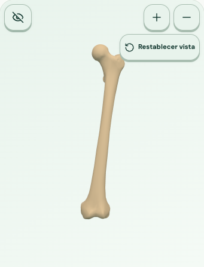
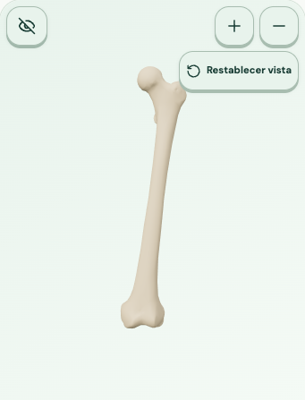
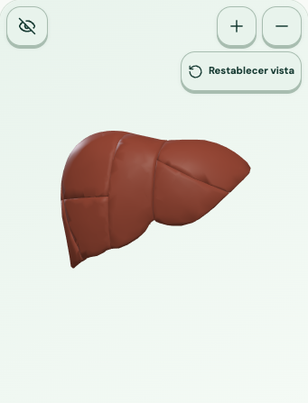
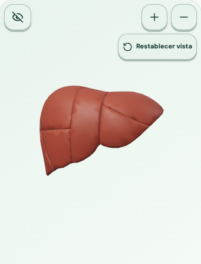

# Prueba del visor de Explorar 3D

## Iluminación a 375 px

Las capturas son del escenario real de `/#explorar/estructura/femur` y `/#explorar/estructura/liver`, con el mismo GLB, encuadre inicial, fondo y controles en las dos condiciones. Se ocultaron las etiquetas para comparar el material y la forma. El escenario mide 341 × 447 px CSS dentro de la pantalla de 375 × 812 px CSS.

| Pieza | Iluminación actual | Estudio local |
| --- | --- | --- |
| Fémur |  |  |
| Hígado |  |  |

El fémur pasa de ocre a marfil y el hígado se ve de un rojo más claro con un brillo más distribuido. Los cortes entre mallas del hígado se ven en ambas condiciones. La iluminación cambia el aspecto de los materiales actuales. La silueta y el detalle anatómico dependen de la geometría.

Una transformación local de Vite en memoria aplicó el prototipo a `src/shared/visor3d/viewport.ts`. La variante usa `RoomEnvironment` de Three.js con PMREM de 256, intensidad ambiental 0,40, ACES Filmic con exposición 1 y salida sRGB explícita. La luz principal cálida llega desde arriba a la izquierda con intensidad 1,9. El relleno frío usa 0,28 y la hemisférica, 0,46. El entorno se genera al montar el visor y al restaurar el contexto WebGL. Se liberan la escena de entorno y el generador tras la captura, y el render target al desmontar. El `GLTFLoader` de la variante recibe `MeshoptDecoder` del paquete Three.js instalado. El mapa de entorno se genera localmente y se reutiliza en los dibujos de ese montaje.

## Método

- Chrome 157.0.8103.79 local sin interfaz, en macOS arm64 con GPU Apple M5 Pro mediante ANGLE Metal. Emulación móvil táctil de 375 × 812 px CSS, DPR 3 y límite del visor a 2. El canvas real dibujó a 682 × 894 píxeles.
- CPU a 4× de ralentización con CDP `Emulation.setCPUThrottlingRate`, GPU de escritorio, servidor Vite local y perfiles de navegador nuevos por muestra. La emulación sirve para comparar cargas de CPU, con verificación pendiente en teléfonos reales.
- Tres muestras por condición, con 1 s de giro de calentamiento, encuadre restablecido mediante `Home` y 3 s de medición. El sentido y el paso fueron constantes, un `ArrowLeft` de 10° por `requestAnimationFrame`. Las etiquetas estaban activadas en los recorridos y las capturas se tomaron antes del giro.
- Se contaron las llamadas efectivas a `renderer.render` de la escena, con el mismo instrumento en las dos variantes. FPS es dibujos efectivos sobre tiempo transcurrido. p50 y p95 son intervalos entre comienzos de dibujos. Los tiempos de render y de proyección miden trabajo síncrono en CPU, incluidos `reportProjection` y el raycast de oclusión. El tiempo de GPU y la presentación de píxeles en pantalla quedan fuera de estas métricas.
- Los GLB candidatos se sirvieron sustituyendo únicamente la respuesta de la URL del GLB en Playwright. La pantalla, ruta, controles, cámara y visor siguieron siendo los del proyecto. Los candidatos contienen la pieza con el ID raíz esperado, sin los nodos de regiones `__parte`. El ensayo de geometría sola conserva la llamada de proyección, donde los anclajes de región se descartan por falta de nodo.
- Para estimar el costo de oclusión con el cráneo candidato, un ensayo adicional mapeó los siete IDs de anotación al nodo raíz `skull`. Los puntos salen de siete rayos horizontales que parten a dos radios de la esfera envolvente. Los ángulos son 0°, 50°, 100°, 155°, 205°, 260° y 310°, con alturas sobre el centro de 0,18, 0,40, −0,09, 0,25, 0,44, 0,05 y −0,22 radios, respectivamente. El ensayo ejecuta la ruta real de proyección y oclusión. Las ubicaciones y la malla única son instrumentación de carga, y la validación de etiquetas, selección y anclas anatómicas queda para una geometría con regiones.

La ejecución local se hizo desde la raíz del repositorio con `node assets/_fuentes/explorar-fase1/visor/measure.mjs` y `node assets/_fuentes/explorar-fase1/visor/measure.mjs --candidates`. Los scripts, métricas JSON completas y nuevos GLB son archivos locales bajo `assets/_fuentes/explorar-fase1/`.

## Geometría actual con las dos iluminaciones

La tabla usa la mediana de tres muestras por condición. «Proyección p50» mide el tramo de CPU desde que termina la llamada a `renderer.render` hasta que termina `reportProjection`.

| Pieza | Luz | Triángulos | FPS | Intervalo p50 (ms) | Intervalo p95 (ms) | Proyección p50 (ms) |
| --- | --- | ---: | ---: | ---: | ---: | ---: |
| Fémur | Actual | 3.204 | 60,0 | 16,6 | 17,7 | 1,4 |
| Fémur | Estudio | 3.204 | 60,0 | 16,7 | 17,5 | 1,4 |
| Cráneo | Actual | 16.977 | 38,6 | 30,2 | 32,8 | 14,0 |
| Cráneo | Estudio | 16.977 | 37,2 | 30,8 | 34,2 | 14,4 |
| Bíceps | Actual | 3.266 | 60,0 | 16,6 | 17,5 | 0,9 |
| Bíceps | Estudio | 3.266 | 60,0 | 16,6 | 17,4 | 1,0 |
| Hígado | Actual | 10.484 | 60,0 | 16,7 | 17,7 | 4,3 |
| Hígado | Estudio | 10.484 | 59,4 | 16,8 | 18,1 | 4,4 |

El p95 del cráneo con estudio ya supera el límite propuesto de 33,3 ms. Su proyección ocupó 14,4 ms de CPU frente a 0,2 ms de `renderer.render`, ambas medianas. El cráneo actual dio alrededor de 28 FPS en un recorrido exploratorio corto y cerca de 20 FPS al coincidir con un render de Blender. Las cifras de la tabla corresponden a la repetición posterior a los trabajos de Blender.

## GLB candidatos con la luz de estudio

| GLB Meshopt | Anclas | Triángulos | Bytes | FPS | Intervalo p50 (ms) | Intervalo p95 (ms) | Proyección p50 (ms) |
| --- | --- | ---: | ---: | ---: | ---: | ---: | ---: |
| Fémur BP3 | Sin anclas válidas | 13.202 | 65.464 | 60,0 | 16,7 | 17,5 | 0,0 |
| Cráneo BP4 | Sin anclas válidas | 329.421 | 1.637.692 | 60,0 | 16,7 | 17,6 | 0,0 |
| Cráneo BP3 reducido | Sin anclas válidas | 48.000 | 530.924 | 60,0 | 16,6 | 17,7 | 0,0 |
| Bíceps BP3 | Sin anclas válidas | 61.614 | 299.316 | 60,0 | 16,7 | 17,5 | 0,0 |
| Hígado HRA, cápsula y área desnuda | Sin anclas válidas | 30.580 | 142.608 | 60,0 | 16,6 | 17,7 | 0,0 |
| Cráneo BP4 | 7 sintéticas | 329.421 | 1.637.692 | 2,6 | 388,7 | 393,1 | 368,0 |
| Cráneo BP3 reducido | 7 sintéticas | 48.000 | 530.924 | 13,5 | 73,7 | 77,4 | 54,5 |

Los cinco candidatos binarios cargaron con `EXT_meshopt_compression` en la ficha real. El cráneo BP4 con anclas produjo ocho dibujos por muestra, por lo que su p95 describe pocos intervalos. El costo síncrono mediano de `renderer.render` fue de 0,2 ms en los dos cráneos con anclas. La proyección y el raycast de oclusión explican la mayor parte del trabajo de CPU durante esos recorridos.

## Presupuesto móvil propuesto

El techo inicial propuesto es de **18.000 triángulos y 400.000 B por GLB comprimido**, con un objetivo de **12.000–15.000 triángulos** para piezas con muchas etiquetas. Para aceptar una pieza, exigir al menos 30 dibujos por segundo y p95 de 33,3 ms o menos durante el giro a escala móvil con CPU 4×, regiones y etiquetas reales. Queda pendiente comprobar ese piso en teléfonos reales.

La proyección y oclusión ya condicionan el presupuesto del cráneo actual. La fuente BP4 y el candidato BP3 de 48.000 triángulos sirven como referencia de detalle para preparar una malla dentro del presupuesto. El fémur BP3 entra en el techo por geometría y peso. El bíceps BP3 y el hígado HRA requieren reducir triángulos para entrar. Las pruebas de aceptación de las nuevas piezas quedan pendientes hasta que tengan sus regiones y anclas definitivas.

## Comprobación de Meshopt y controles

Una copia comprimida del fémur actual conservó los nodos de región. Con `controls.mjs --compressed` se verificaron en Chrome sus etiquetas, giro, zoom, restablecimiento, resaltado y limpieza de selección de los cóndilos. El visor volvió al estado listo tras pérdida y restauración de WebGL inducidas con `WEBGL_lose_context`, y volvió a cargar al regresar desde el catálogo. La prueba comparó píxeles del modelo ocultando el área de los controles.
