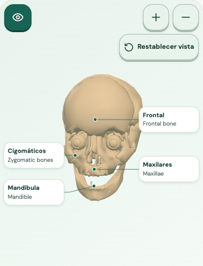
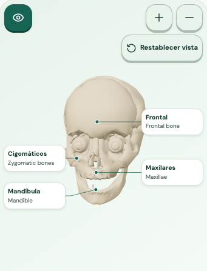
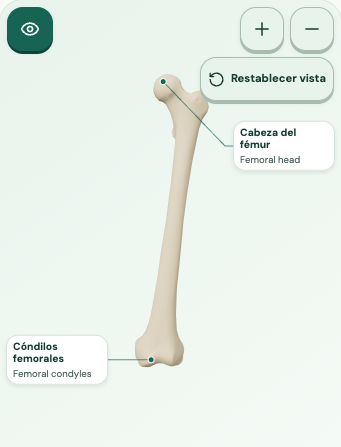
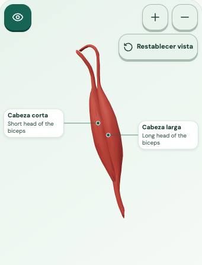
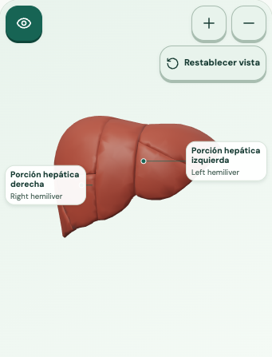
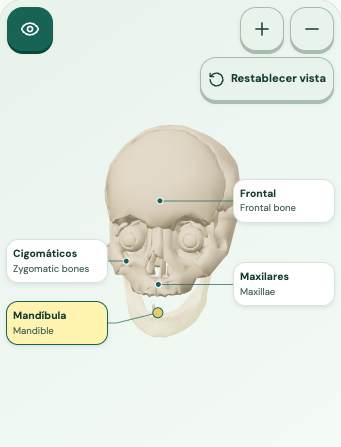
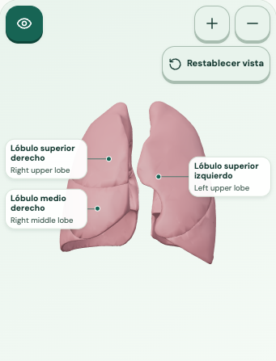

# Explorar 3D · Fase 2, etapa A

## Protocolo

- Aplicación compilada para producción con Vite. Cada muestra abrió la ficha real desde su ruta `/#explorar/estructura/<id>` en un perfil nuevo, con las regiones seleccionables y las etiquetas activadas. Las fichas se enumeraron desde el catálogo.
- Chrome 157.0.8103.79 sin interfaz, en macOS arm64 con GPU Apple M5 Pro mediante ANGLE Metal. Emulación táctil de 375 × 812 píxeles CSS, DPR del dispositivo 3 y tope del visor 2. El escenario mide 341 × 447 píxeles CSS y el lienzo dibuja a 682 × 894 píxeles.
- CPU ralentizada 4× mediante CDP. Tras un segundo de giro de calentamiento, se restableció la vista y se midieron tres segundos de giro, con una pulsación de flecha izquierda por `requestAnimationFrame`. Los FPS cuentan dibujos reales del visor por segundo. Para el p95 se tomó el percentil 95 de los intervalos entre inicios de dibujo consecutivos.
- Los triángulos se contaron en la escena del GLB que descargó cada ficha. El peso corresponde al archivo completo comprimido con Meshopt, en kB decimales (1 kB = 1.000 B). Los límites de la etapa son 40.000 triángulos por ficha habitual, 60.000 por ficha compleja y 800 kB por GLB. El mínimo durante el giro es 30 FPS con p95 ≤ 33,3 ms.

La emulación ralentiza la CPU del navegador y utiliza la GPU de escritorio.

## Configuración técnica

El visor carga `three-mesh-bvh` 0.9.18 (MIT) con Three 0.187.0. Construye los árboles de oclusión al cargar la malla y los libera al desmontar. Calcula la posición de las etiquetas en cada dibujo y comprueba la oclusión unas 15 veces por segundo durante el giro, con una última comprobación al detenerse. El clic sigue usando el raycast nativo. [three-mesh-bvh 0.9.18](https://www.npmjs.com/package/three-mesh-bvh/v/0.9.18)

Explorar aplica RoomEnvironment y PMREM local, tone mapping ACES y salida sRGB. Los 24 GLB de la capa `explore` se cargan bajo demanda y se decodifican con el Meshopt incluido en Three. La compilación precarga **16.657.406 bytes**. Los hashes SHA-256 de los 187 clips MP3 existentes coinciden con `04dda26`.

## Las 24 fichas

Las 24 fichas sirvieron 24 GLB comprimidos distintos. El mayor peso fue de **116,880 kB** (corazón) y el mayor recuento fue de **18.497 triángulos** (pulmones). Durante el giro, el mínimo fue de **59,98 FPS** y el p95 más alto de **17,9 ms**.

| Ficha | Triángulos | kB Meshopt | Regiones | Etiquetas visibles al abrir | FPS | p95 (ms) |
| --- | ---: | ---: | ---: | ---: | ---: | ---: |
| Fémur | 3.204 | 21,200 | 3 | 2 | 60,01 | 17,6 |
| Tibia | 1.692 | 13,472 | 3 | 2 | 60,01 | 17,4 |
| Húmero | 3.700 | 23,036 | 3 | 2 | 60,00 | 17,5 |
| Radio | 632 | 7,516 | 3 | 1 | 60,00 | 17,7 |
| Hueso coxal | 2.332 | 17,740 | 4 | 3 | 60,00 | 17,7 |
| Rótula | 310 | 5,912 | 3 | 2 | 60,00 | 17,8 |
| Cúbito | 824 | 8,428 | 3 | 3 | 60,00 | 17,4 |
| Peroné | 1.124 | 10,268 | 3 | 3 | 60,00 | 17,9 |
| Esternón | 2.499 | 16,876 | 3 | 3 | 60,00 | 17,3 |
| Cráneo | 16.977 | 98,040 | 7 | 4 | 60,01 | 17,8 |
| Columna vertebral | 15.870 | 91,672 | 7 | 7 | 60,00 | 17,4 |
| Bíceps braquial | 3.266 | 20,028 | 2 | 2 | 60,00 | 17,5 |
| Cuádriceps femoral | 4.797 | 29,784 | 4 | 3 | 60,00 | 17,8 |
| Deltoides | 4.797 | 28,116 | 3 | 1 | 60,00 | 17,8 |
| Tríceps braquial | 4.800 | 28,192 | 3 | 2 | 60,00 | 17,6 |
| Gastrocnemio | 4.800 | 27,672 | 2 | 2 | 59,98 | 17,6 |
| Corazón | 16.604 | 116,880 | 15 | 3 | 59,99 | 17,4 |
| Pulmones | 18.497 | 99,044 | 5 | 3 | 60,03 | 17,4 |
| Estómago | 1.810 | 14,800 | 4 | 4 | 60,01 | 17,6 |
| Riñones | 5.292 | 29,332 | 2 | 2 | 60,02 | 17,8 |
| Cerebro | 16.991 | 98,568 | 4 | 3 | 60,01 | 17,9 |
| Hígado | 10.484 | 61,480 | 3 | 2 | 60,00 | 17,4 |
| Intestino delgado | 13.000 | 72,208 | 3 | 2 | 60,00 | 17,4 |
| Intestino grueso | 9.950 | 60,296 | 6 | 5 | 59,99 | 17,5 |

## Comparación del cráneo

El cráneo conserva sus 16.977 triángulos, ocho mallas, siete regiones seleccionables y siete anclajes. La descarga pasa de **1.148,896 kB** del banco compartido en `04dda26` a **98,040 kB** del GLB individual, una reducción de **91,5 %**.

| Compilación | Ronda | FPS | p95 de dibujo (ms) | p50 de proyección durante el dibujo (ms) | Proyección total (ms/s) |
| --- | ---: | ---: | ---: | ---: | ---: |
| Antes | 1 | 59,45 | 18,1 | 13,5 | 805,3 |
| Antes | 2 | 56,91 | 19,2 | 14,0 | 801,0 |
| Antes | 3 | 56,85 | 19,2 | 14,2 | 810,6 |
| Etapa A | 1 | 60,01 | 17,8 | < 0,1 | 5,1 |
| Etapa A | 2 | 60,01 | 17,2 | < 0,1 | 4,8 |
| Etapa A | 3 | 60,02 | 17,9 | < 0,1 | 5,1 |

La proyección total suma el tiempo síncrono de las llamadas de proyección por segundo, entre dibujos además de durante el dibujo cuando hay una actualización de oclusión programada. La compilación anterior ya cumplía el piso en producción, con una mediana de proyección de 14,0 ms durante el dibujo. El BVH reduce el costo de cada prueba y el muestreo de oclusión limita cuántas se realizan durante el giro.

La comparación interactiva coincide en las etiquetas visibles y su selección en ocho estados del cráneo, con un desplazamiento máximo de 0,002 px CSS en los anclajes. Se comprobó la selección de Mandíbula por etiqueta y por toque sobre su malla, el ocultamiento de etiquetas, el zoom, el restablecimiento y la oclusión del Frontal en la vista posterior. La iluminación de estudio modifica la apariencia de la superficie.

| Antes (04dda26) | Etapa A |
| --- | --- |
|  |  |

## Capturas del atlas a 375 px

| Fémur | Bíceps braquial | Hígado |
| --- | --- | --- |
|  |  |  |

## Corrección del arranque del visor

En `c594093`, la compilación y los tests unitarios pasaron en GitHub Actions. Dos pruebas de navegador agotaron sus límites. La prueba del catálogo dedicó **54,225 s** a esperar el visor de las primeras nueve fichas dentro de un límite de **60 s**. Sus esperas completas de `ready` duraron **5,790–6,598 s** por ficha. El clic en «Practicar esta estructura» de Pulmones encontró el enlace y agotó los **5 s** de la acción. [GitHub Actions 45034182615](https://github.com/Carlaandrea22/frasivo_RA/actions/runs/45034182615)

La sonda local en SwiftShader midió una pausa de **494–759 ms** dentro del primer `renderer.setSize()` en Cráneo, Pulmones y Columna vertebral. Esa llamada se ejecutaba después de generar el PMREM y antes de solicitar el GLB.

Con la corrección, el visor se declara listo al dibujar el modelo con luces directas y proyectar sus etiquetas. Después de dar al navegador una oportunidad de pintar, construye el BVH en un worker y carga el entorno prefiltrado de RoomEnvironment. Las etiquetas se vuelven a comprobar al instalar el BVH. Las 24 fichas sirvieron los mismos GLB individuales de `c594093`. El entorno prefiltrado pesa 1.090.447 bytes.

La repetición local usa un contexto nuevo para cada ruta, el viewport táctil de 375 × 812 px, DPR 3 con tope 2 y CPU 4× en Chrome 157. El giro se mide en Metal con el protocolo anterior. Las mediciones de arranque incluyen Metal y SwiftShader en el mismo Mac.

### Giro de las 24 fichas

En Metal, **24/24** fichas cumplieron ambos límites durante el giro. El mínimo fue de **59,98 FPS** y el p95 más alto fue de **18,60 ms**. La muestra de giro comenzó con la iluminación y la oclusión instaladas.

| Ficha | FPS antes → corrección | p95 antes → corrección (ms) | Ready SwiftShader (ms) | Ready Metal (ms) |
| --- | ---: | ---: | ---: | ---: |
| Fémur | 60,01 → 60,00 | 17,60 → 18,50 | 1.082,8 → 531,5 | 567,3 → 506,6 |
| Tibia | 60,01 → 59,98 | 17,40 → 18,50 | 1.104,9 → 527,3 | 559,6 → 512,0 |
| Húmero | 60,00 → 59,98 | 17,50 → 18,60 | 1.101,0 → 518,3 | 567,0 → 513,9 |
| Radio | 60,00 → 60,03 | 17,70 → 18,10 | 1.083,8 → 520,1 | 556,8 → 508,9 |
| Hueso coxal | 60,00 → 60,00 | 17,70 → 18,50 | 1.118,6 → 526,1 | 569,5 → 508,9 |
| Rótula | 60,00 → 59,99 | 17,80 → 18,10 | 1.083,4 → 532,5 | 563,6 → 513,6 |
| Cúbito | 60,00 → 59,99 | 17,40 → 18,60 | 1.111,5 → 520,8 | 558,5 → 508,8 |
| Peroné | 60,00 → 60,02 | 17,90 → 18,20 | 1.079,4 → 525,7 | 570,2 → 505,0 |
| Esternón | 60,00 → 60,04 | 17,30 → 18,20 | 1.092,6 → 521,2 | 563,2 → 512,8 |
| Cráneo | 60,01 → 60,00 | 17,80 → 18,30 | 2.443,4 → 1.530,6 | 594,0 → 530,3 |
| Columna vertebral | 60,00 → 60,02 | 17,40 → 18,40 | 1.112,0 → 525,2 | 582,5 → 510,6 |
| Bíceps braquial | 60,00 → 60,04 | 17,50 → 18,50 | 1.094,9 → 528,7 | 562,2 → 513,5 |
| Cuádriceps femoral | 60,00 → 59,99 | 17,80 → 18,60 | 1.090,7 → 522,8 | 573,5 → 506,2 |
| Deltoides | 60,00 → 59,99 | 17,80 → 18,20 | 1.119,1 → 531,2 | 562,1 → 504,9 |
| Tríceps braquial | 60,00 → 60,02 | 17,60 → 18,10 | 1.100,0 → 530,8 | 578,0 → 511,9 |
| Gastrocnemio | 59,98 → 60,04 | 17,60 → 18,50 | 1.124,1 → 517,6 | 564,9 → 503,3 |
| Corazón | 59,99 → 60,00 | 17,40 → 18,30 | 1.140,2 → 532,8 | 586,4 → 516,7 |
| Pulmones | 60,03 → 59,99 | 17,40 → 18,40 | 1.127,1 → 525,6 | 591,9 → 514,6 |
| Estómago | 60,01 → 60,00 | 17,60 → 18,40 | 1.093,7 → 528,8 | 563,9 → 504,3 |
| Riñones | 60,02 → 59,99 | 17,80 → 18,00 | 1.089,6 → 525,8 | 577,3 → 511,2 |
| Cerebro | 60,01 → 60,02 | 17,90 → 18,20 | 1.180,8 → 525,7 | 571,7 → 509,4 |
| Hígado | 60,00 → 59,99 | 17,40 → 18,10 | 1.118,2 → 537,3 | 568,9 → 506,6 |
| Intestino delgado | 60,00 → 60,03 | 17,40 → 17,90 | 1.104,6 → 525,9 | 576,1 → 508,1 |
| Intestino grueso | 59,99 → 60,02 | 17,50 → 18,10 | 1.125,8 → 527,2 | 575,6 → 508,6 |

### Arranque en producción

Visor listo, partes y primera proyección se miden desde la navegación. PMREM indica el tiempo síncrono de generación antes de la corrección. La corrección usa iluminación prefiltrada y mide por separado la descarga, la descompresión y el primer dibujo con la textura. Para BVH, antes se suma la creación síncrona de los árboles y en la corrección se mide desde la preparación de los datos hasta su recepción e instalación desde el worker.

| GPU (medianas de 24 fichas) | Visor listo (ms) | Partes en DOM (ms) | Primera proyección (ms) | Generación PMREM (ms) | Carga de entorno (ms) | BVH (ms) |
| --- | ---: | ---: | ---: | ---: | ---: | ---: |
| SwiftShader | 1.104,8 → 526,0 | 130,2 → 129,0 | 1.100,7 → 522,5 | 57,4 → 0,0 | 92,2 | 8,1 → 39,4 |
| Metal | 569,2 → 509,1 | 128,3 → 126,6 | 565,2 → 504,4 | 55,3 → 0,0 | 43,7 | 7,2 → 50,2 |

| Ficha | GPU | Visor listo (ms) | Partes en DOM (ms) | Primera proyección (ms) | Generación PMREM (ms) | Carga de entorno (ms) | BVH (ms) |
| --- | --- | ---: | ---: | ---: | ---: | ---: | ---: |
| Cráneo | SwiftShader | 2.443,4 → 1.530,6 | 139,5 → 130,6 | 2.438,4 → 1.524,4 | 58,2 → 0,0 | 120,3 | 17,8 → 206,6 |
| Cráneo | Metal | 594,0 → 530,3 | 125,2 → 132,1 | 589,1 → 525,7 | 58,8 → 0,0 | 48,9 | 19,6 → 38,1 |
| Pulmones | SwiftShader | 1.127,1 → 525,6 | 131,9 → 130,8 | 1.122,3 → 521,8 | 58,1 → 0,0 | 123,4 | 18,9 → 38,4 |
| Pulmones | Metal | 591,9 → 514,6 | 132,0 → 131,2 | 587,2 → 509,4 | 57,0 → 0,0 | 41,6 | 19,0 → 52,8 |
| Columna vertebral | SwiftShader | 1.112,0 → 525,2 | 129,5 → 128,0 | 1.106,9 → 520,6 | 56,3 → 0,0 | 100,0 | 17,4 → 108,7 |
| Columna vertebral | Metal | 582,5 → 510,6 | 130,2 → 126,9 | 577,4 → 505,2 | 54,6 → 0,0 | 43,2 | 19,1 → 51,6 |

Las 24 fichas instalaron la textura y al menos un árbol BVH después del primer dibujo en ambos backends. La primera ficha de cada lote incluye el primer uso de WebGL del proceso de Chrome. [Mediciones por ficha y GPU](arranque-24-fichas.csv)

### Capturas de la corrección a 375 px

En Cráneo coincidieron las etiquetas visibles, la selección y las coordenadas de los anclajes en ocho estados. La vista inicial produjo el mismo PNG que en la primera ejecución de la etapa A. Se verificaron la selección de Mandíbula desde la etiqueta y al tocar la malla, y la oclusión del Frontal en la vista posterior. [Vista inicial de la etapa A](visor-skull-despues.png)

| Cráneo | Pulmones |
| --- | --- |
|  |  |

### Pruebas de regresión

Las dos pruebas que fallaron en Actions pasaron tres veces seguidas con Chrome en SwiftShader y CPU 4×. En la repetición con la ralentización aplicada desde la sesión CDP de Playwright, el clic de Pulmones se completó en 65–121 ms. Una prueba mínima con service worker aisló el efecto de abrir una segunda sesión CDP, que restablecía `navigator.onLine` al recargar. Usar una sola sesión conservó la desconexión simulada y los límites de tiempo originales. La suite completa pasó **110/110** en SwiftShader con CPU 4× y un worker. El build y las **142** pruebas unitarias pasaron. La comparación de píxeles del fémur espera a que se instale la misma iluminación para las dos capturas y conserva las comprobaciones de selección. La precarga de la corrección ocupa **17.918.577 bytes**. [Generador local de RoomEnvironment](../../../../../scripts/generate-explorar-environment.mjs)
